# CLI Architecture

## GitHub automation artifact lifecycle

The journal-driven worktree discard path retains dirty source while
`daemon/automations/githubWorktreeArtifactReclaim` reclaims old ignored dependencies
and build outputs in registered daemon-owned automation worktrees. It verifies
Git ownership, tracked descendants, nested repositories, recent activity and
daemon/OS process use immediately before deletion. Incomplete process observation
preserves the files. Receipts outside Git worktrees retain the daily check interval
across restarts; the existing automation tick owns retries. Clean worktree deletion
and tombstone-based Chat resume keep their existing lifecycle.
The policy and reconsideration boundaries are in
[the implementation plan](plans/github-automation-artifact-reclaim.md).

## Worktree Git write ownership

Ticket-validated worktree writes share Desktop's common Git directory lock.
Daemon shutdown and self replacement stop accepting new serialized writes and
await the accepted queue before releasing daemon ownership and exiting. A live
Git child must finish before its lock is released. Unexpected termination such
as SIGKILL cannot run this drain: lock refusal includes the path for recovery
after verifying that no writer remains. Foreign locks are never automatically
removed. Revisit crash recovery only with a shared owner-identity protocol across
Desktop, web runners and the daemon; PID-only stale detection is not sufficient.

An unused Codex Happy session can outlive its first process: the daemon reaps
empty processes before a delayed first schedule runs. After the existing
identity, encryption, directory and resume-fence checks, the daemon may start
Codex without a provider `--resume` only when both the fresh server sequence and
processed cursor are zero. The reconnect envelope still binds the original
Happy session ID. Missing threads in nonempty or unverified sessions remain an
error; this is not context-loss recovery. Reconnected turns inherit the stored
model and effort pins unless explicit launch seeds override them. For Codex,
the command's `--model` overrides `HAPPY_INITIAL_MODEL`, which overrides the
stored model pin. The one-shot environment seed is consumed even when the
command model wins, preventing inheritance by child processes. Revisit the
zero-sequence proof if session creation begins writing durable messages.

This document describes the Happy CLI (`packages/happy-cli`) and its daemon. The CLI is both an interactive tool and a background session manager that keeps machine state in sync with the server.

## Input evidence and native wire turns

Provider/session mappers own wire turn starts, ends and routing identity.
`TurnInputEvidence` only stamps existing mapped turns and publishes evidence
revisions when the consumer explicitly opts in through the validated session
launch setting (`environmentVariables.HAPPY_INPUT_EVIDENCE="1"`); Claude/Codex
default off. Runners consume the seed once and retain a session-owned value
through replacements and resume/recovery; daemon/new-session boundaries scrub
implicit inheritance. Both retryable startup metadata refreshes reapply that
captured setting on each CAS attempt while retaining the newest unrelated
metadata; explicit OFF cannot recover as ON after a concurrent title edit.
OFF adds neither T2rt contact capabilities nor its extra
Codex non-channel final/empty-plan events. Guards received while OFF are refused;
ON advertises guarded prompting together with its admission receipts. A final without
a mapped turn produces an incomplete revision with no
envelope turn ID; its payload correlation token cannot become a turn or retry
root. It cannot create lifecycle events for automation, daemon follow-ups or
Desktop consumers. Main's behavior, including missing textless completion, is
preserved. The source-parity regression and reconsideration boundary are recorded
in [the T2rt report](reason-network-t2rt.md#t2rt-19-structural-correction-evidence-never-owns-wire-turns-2026-10-26).
The [T2 hand-off](reason-network-t2rt.md#t2-hand-off-explicit-consumer-opt-in)
defines the launching consumer's ownership and required reader compatibility.
The hard T2 caller contract beside T2RT-21 requires fresh live evidence-ON
discovery and a bounded admission-receipt timeout; cached advertisements or
durable message storage do not prove delivery. OFF never executes guarded prompts.

Happy-app metadata parsing passes through unknown keys, including nested runtime
capabilities and summary fields. Title CAS retries merge only app-owned title
fields onto the latest server document; acknowledged metadata and version stay
together in its cache. Live CLI hosts do not restore omitted evidence/contact
markers on observation or ordinary post-startup metadata writes/CAS retries.
OFF mode changes never publish metadata or delete incoming contacts, including
stale or foreign runtime
advertisements. Observed capabilities cannot enable an OFF host. Recovery prefers
validated daemon-saved environment, then original-session metadata, with an
explicit validated request overriding either. If an old app strips the hint and
no validated saved setting survives, metadata-only recovery safely defaults OFF;
this cannot incorrectly enable evidence. See the
[T2RT-29 writer audit](reason-network-t2rt.md#t2rt-29-metadata-writer-preservation-and-live-repair-2026-10-26)
and [T2RT-32 OFF parity](reason-network-t2rt.md#t2rt-32-off-mode-transitions-never-publish-metadata-2026-10-26).

## Unconfigured synced plugin MCP servers

Claude loads synced plugin MCP definitions independently of Happy's injected
gateway servers. The SDK query adapter excludes blank HTTP/SSE URLs in default
synced plugin configurations using session-only `deniedMcpServers` entries.
It does not edit the sync cache or persist a disabled flag: a URL configured
later must become eligible on the next query. Configured servers, custom
manifest MCP definitions, and ambiguous copies across accounts are left to
the SDK. Revisit this boundary if Claude changes its synced plugin layout or
server naming, or stops loading unconfigured placeholders itself.

## System overview

### Readiness of daemon-owned children

A child launched directly by the online daemon can reuse that parent without
another loopback health request when the OS parent PID, running state, connected
socket, CLI version and daemon lock owner agree, and the parent is still alive.
The state must also contain a bound control port and control credentials. An
online UI snapshot or `--started-by daemon` argument alone is not this proof.
This avoids a transient two-second health timeout aborting a conversation that
the same daemon has just accepted and spawned. Authenticated session reports,
machine/account identity and session authorization remain unchanged.

Terminal launches, mismatched or incomplete records, disconnected parents and
launchers with an intermediate parent retain normal health verification and
automatic daemon startup. Revisit this shortcut if spawning stops preserving
direct OS parentage; an intermediary must use the verified fallback rather than
an environment flag that bypasses ownership checks.

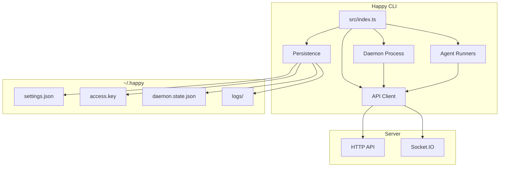

## High-level layout
- **Entry point:** `src/index.ts` parses subcommands and routes execution.
- **API client:** `src/api` handles HTTP + Socket.IO, encryption, and RPC.
- **Daemon:** `src/daemon` runs in the background, spawns sessions, and maintains machine state.
- **Persistence/config:** `src/persistence.ts` + `src/configuration.ts` manage local state in `~/.happy`.
- **Agents:** `src/claude`, `src/codex`, `src/gemini` provide provider-specific runners.

## CLI entry flow

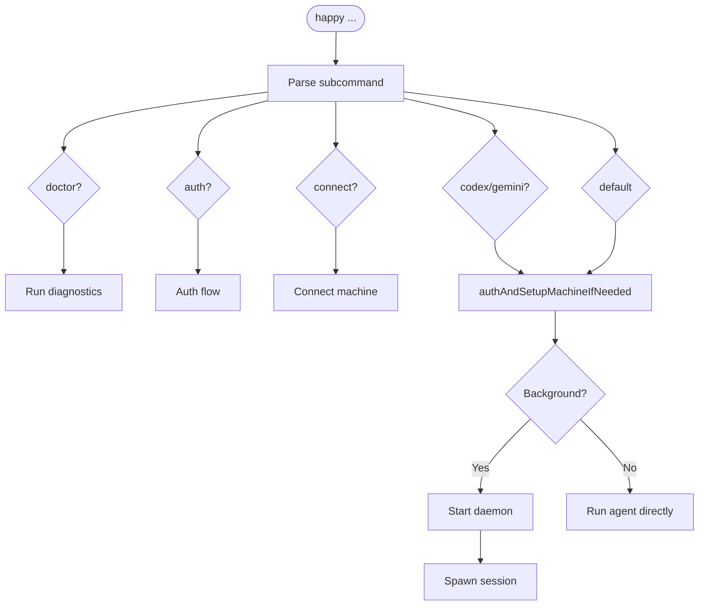

`src/index.ts` is the CLI router. It:
- Parses subcommands (`doctor`, `auth`, `connect`, `codex`, `gemini`, and default run flows).
- Ensures auth and machine setup when needed (`authAndSetupMachineIfNeeded`).
- Starts the daemon or runs an agent directly based on subcommand/context.

## Daemon caller-grant recipient

The daemon's MCP caller-grant public key belongs to its current process. Machine registration seeds it before the API machine client is created; daemon-state updates reapply that recipient on every compare-and-swap retry. A conflict can return the previous process's persisted state, whose public key must not replace the running daemon's recipient: otherwise Desktop seals grants that this daemon cannot open. Revisit this ownership if the grant key is intentionally rotated within one process or runtime attachment stops seeding the current recipient.

## Local state and configuration

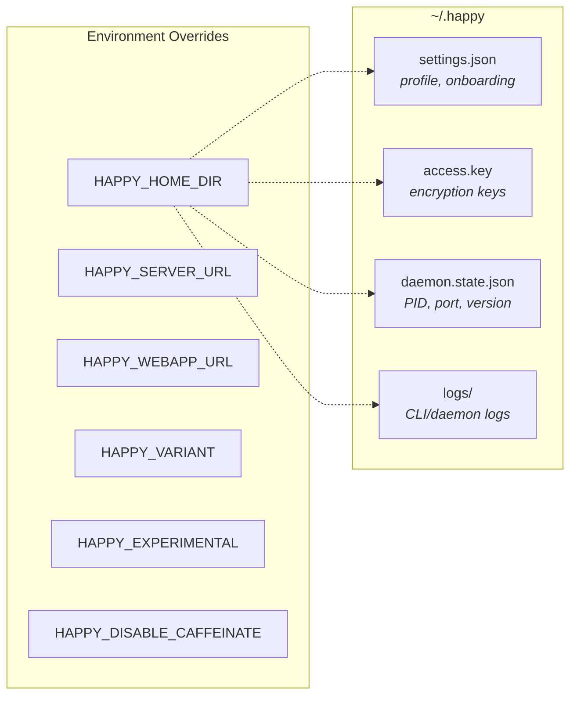

Local state lives under `~/.happy` (or `HAPPY_HOME_DIR`):
- `settings.json`: onboarding and profile settings (validated/migrated).
- `access.key`: local key material for encryption/auth.
- `daemon.state.json`: daemon PID + control port + version.
- `logs/`: CLI/daemon logs.

Configuration lives in `src/configuration.ts`:
- `HAPPY_SERVER_URL` and `HAPPY_WEBAPP_URL` override defaults.
- `HAPPY_VARIANT`, `HAPPY_EXPERIMENTAL`, `HAPPY_DISABLE_CAFFEINATE` control behavior.

## API client architecture

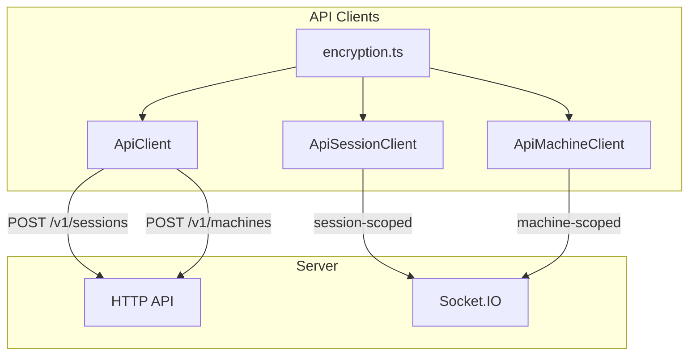

### HTTP
`ApiClient` (`src/api/api.ts`) handles:
- Session creation (`POST /v1/sessions`) with encrypted metadata/state.
- Machine registration (`POST /v1/machines`) with encrypted metadata/daemon state.
- Other CRUD actions through `ApiSessionClient` and `ApiMachineClient`.

### WebSocket

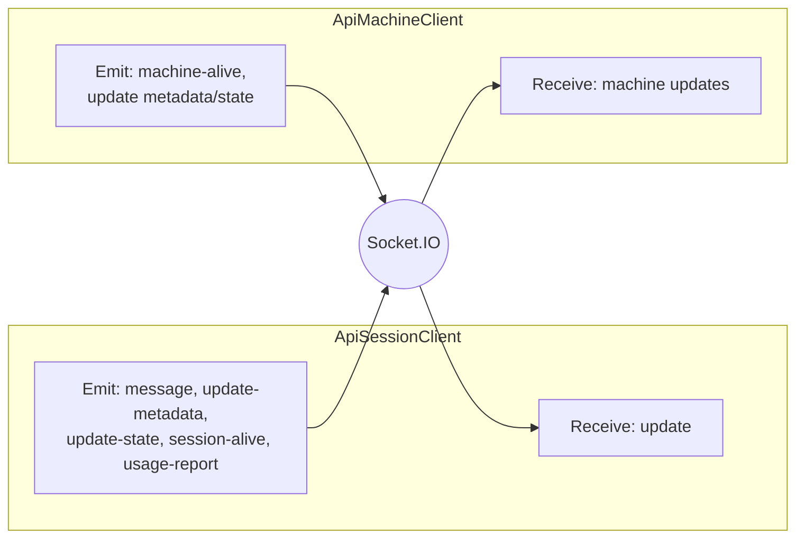

`ApiSessionClient` (`src/api/apiSession.ts`) connects to Socket.IO as a **session-scoped** client:
- Receives `update` events and decrypts message content.
- Emits `message`, `update-metadata`, `update-state`, `session-alive`, and `usage-report`.

`ApiMachineClient` (`src/api/apiMachine.ts`) connects as a **machine-scoped** client:
- Sends `machine-alive` heartbeats.
- Updates machine metadata/daemon state with optimistic concurrency.
- Receives machine updates and merges them locally.

### Encryption

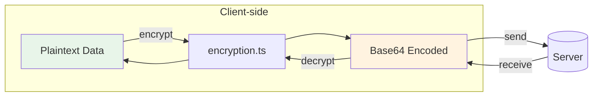

The CLI encrypts client content before it leaves the machine using `src/api/encryption.ts`.
- Session metadata, agent state, messages, machine state, artifacts, and KV values are encrypted client-side.
- On-wire encoding is base64; see `encryption.md`.

## Daemon architecture

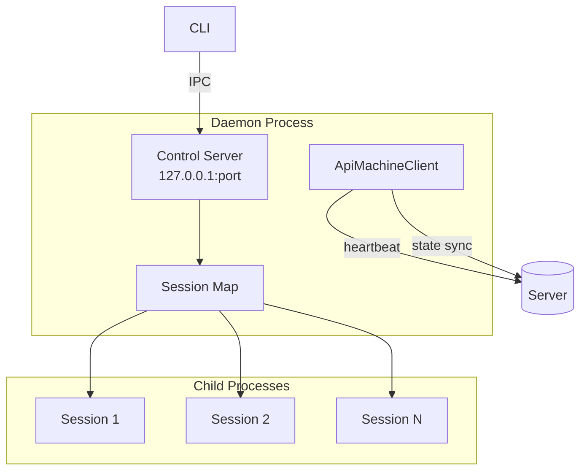

The daemon is a long-lived process responsible for running sessions in the background and maintaining machine presence.

### Lifecycle

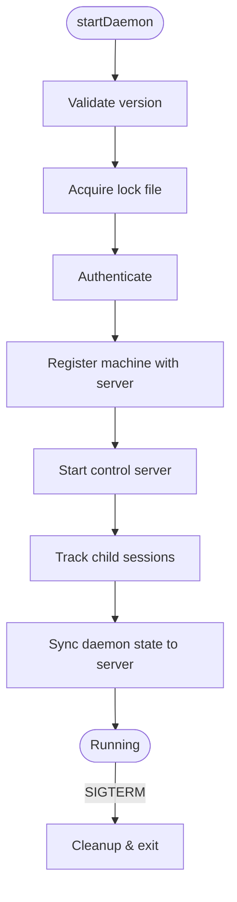

1. `startDaemon()` validates the running version and acquires a lock file.
2. It authenticates and registers the machine with the server.
3. It starts a local **control server** for IPC.
4. It keeps a map of tracked child sessions and updates daemon state on the server.

### Control server (local IPC)

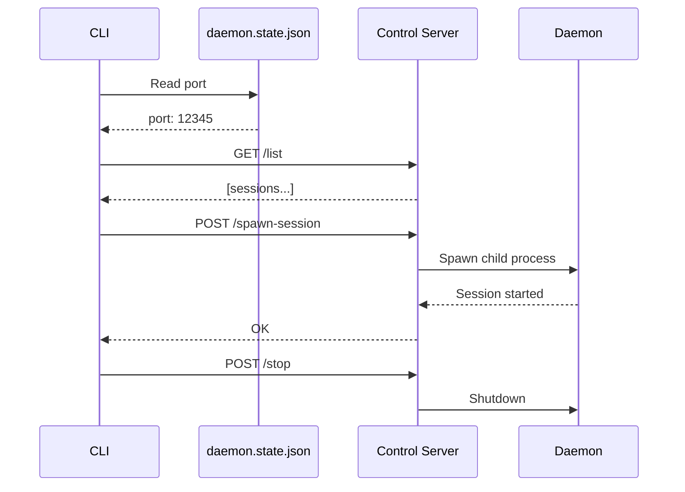

`startDaemonControlServer()` (`src/daemon/controlServer.ts`) runs an HTTP server on `127.0.0.1` and exposes:
- `/list` (list active sessions)
- `/stop-session`
- `/spawn-session`
- `/stop` (shutdown daemon)
- `/session-started` (session self-report)

The CLI talks to this server via `controlClient.ts`, using a port stored in `daemon.state.json`.

### Session spawning

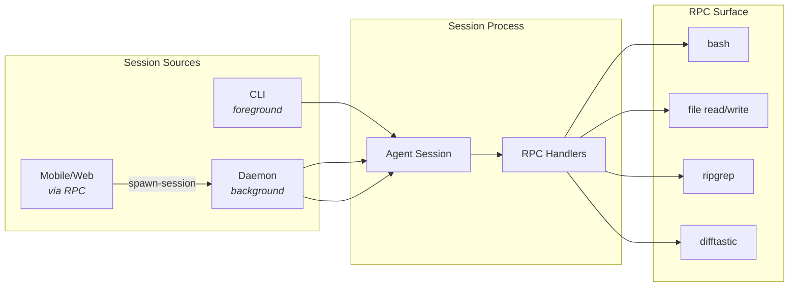

Sessions can be started by:
- The CLI directly (foreground).
- The daemon (background).
- Remote requests over RPC (from mobile/web via machine connection).

Daemon session spawning uses `registerCommonHandlers` to expose a controlled RPC surface (shell commands, file operations, search/diff helpers).

### Machine state

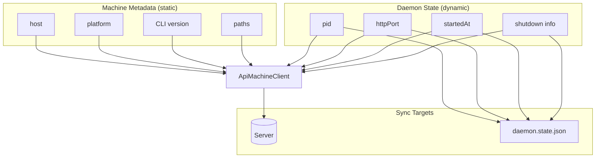

- **Machine metadata** is static info (host, platform, CLI version, paths).
- **Daemon state** is dynamic (pid, httpPort, startedAt, shutdown info).

The daemon updates these via `ApiMachineClient` and mirrors local state into `daemon.state.json` for control/diagnostics.

## RPC and tool bridge

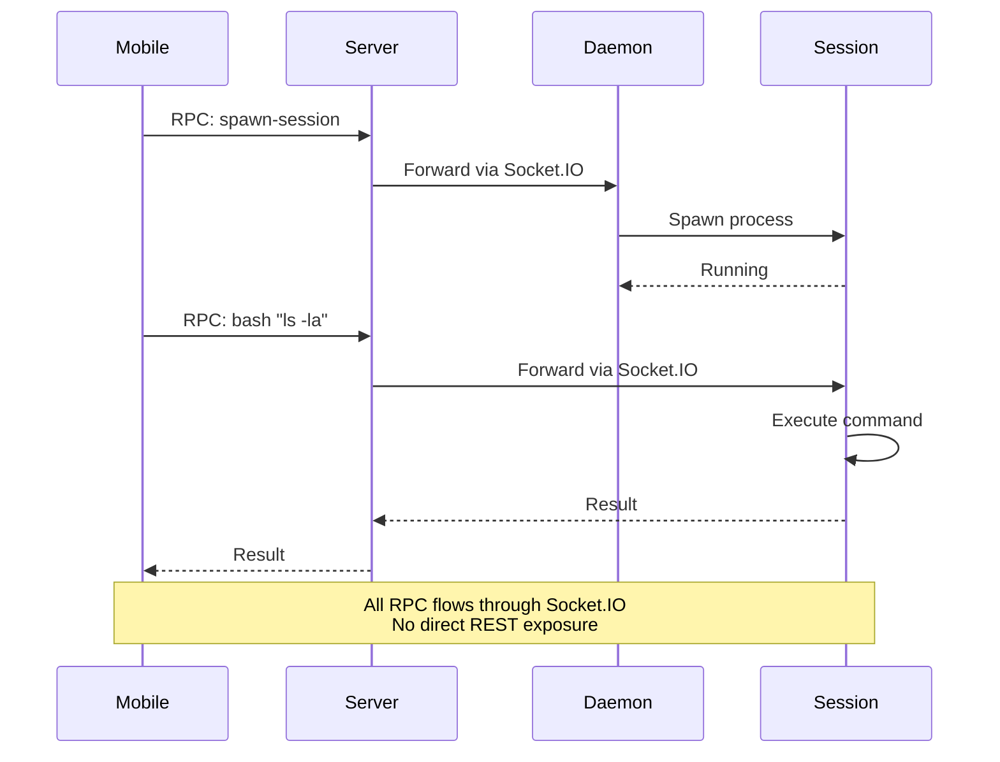

RPC is used to send commands over the Socket.IO connection:
- Sessions register RPC handlers (e.g., `bash`, file read/write, `ripgrep`, `difftastic`).
- The daemon registers a spawn-session handler so the server/mobile client can ask it to start a local session.

This mechanism allows the server and mobile clients to drive local actions without exposing a broad REST surface.

## Session Happy MCP response format

The session Happy MCP server (`startHappyServer.ts`) answers every request as plain JSON
(`enableJsonResponse: true`), not as an SSE stream. Endpoint security holds back
`text/event-stream` replies. On a Windows PC with Avast real-time protection, every new
Claude session waited out Claude Code's ~30s MCP connect timeout with `happy` still
`pending`. Both a direct claude.exe HTTP connection and the `happy-mcp.mjs` stdio bridge
were affected, so a transport switch does not help. The same SDK server with JSON replies
connected normally (2026-10-22, #913). No Happy tool sends server-to-client notifications,
so JSON replies lose nothing. Revisit if a tool needs progress, logging or `list_changed`
notifications during a call: those require the SSE path, and the AV stall would then need
another answer.

## Implementation references
- CLI entry: `packages/happy-cli/src/index.ts`
- Daemon: `packages/happy-cli/src/daemon`
- Control server/client: `packages/happy-cli/src/daemon/controlServer.ts`, `packages/happy-cli/src/daemon/controlClient.ts`
- API clients: `packages/happy-cli/src/api`
- Persistence: `packages/happy-cli/src/persistence.ts`
- Config: `packages/happy-cli/src/configuration.ts`

## Worktree dependency pressure reclaim

The authenticated machine RPC `worktree-dependencies:reclaim` accepts `{ path }` within
that daemon's allowed workspace root. Its process-wide queue coalesces canonical
primary-repository requests and serializes deletion across repositories, including
reconnected machine clients. `src/daemon/worktreeDependencyReclaim.ts` owns the filesystem
safety checks; `worktreeDependencyReclaimRpc.ts` owns request validation and scheduling.

Storage below `min(10%, 40GiB)` triggers reclaim, stopping at `min(15%, 60GiB)`.
Only registered `.aplus/worktrees` descendants' ignored `node_modules` are eligible.
Oldest-first execution handles >=7 day idle dependencies before the >=24 hour fallback.
Lock, cwd, symlink, registration, idle activity, nearest Git-root ignore and force-tracked
file checks are repeated immediately before deletion. Failed process inventory stops
reclaim; normal-capacity calls do not enumerate Git or scan processes/directories.
Source, branches and local edits are retained. The response separates diagnostic `du`
bytes from before/after physical free space because APFS clones and pnpm hardlinks do
not release independent blocks. This RPC is available from candidate .206 only after
publication; Desktop scheduling is a separate consumer rollout. It does not install a
background timer by itself. Revisit ownership if another privileged service takes over
machine filesystem lifecycle; revert by removing the consumer calls before removing RPC.


## Organization-shared difficulty routing

`difficultyRoutingRuntime.ts` owns automatic Claude/Codex turn selection after a
client supplies the versioned intent and a signed APlus user authorization. It
validates the turn through the APlus API, applies P1, conditionally sends encrypted
raw text for P2, and applies sticky/escalation policy within the allowed model
snapshot. Manual selections and legacy messages retain their existing behavior.
Selection state and the `difficulty-routing` session event are recorded after
queue acceptance; client metadata is not an authoritative execution result.

The daemon advertises its ephemeral host public key and polls the APlus host
election endpoint. Only the elected, enabled shared machine prepares the pinned
artifacts. `daemon/difficultyRoutingClassifierHost.ts` owns one worker, one native
job, a bounded queue, revocation checks before decryption/dequeue, and process
termination. A caller timeout never frees an active native slot. The worker starts
before provider initialization with a minimal environment and receives no user or
organization credential. Its process lifetime bounds native memory retention.
The fixed fp32 model has measured worker RSS around 3.24 GiB on macOS arm64; this
is not the size of the daemon or a cross-platform memory guarantee.

Client authorization and runtime routing budgets are 250ms and 750ms respectively,
with no classification retry. Failure preserves a validated P1 or legacy fallback,
not a forged shared-classifier success. Explicit empty/malformed raw prompt
overrides skip classification rather than falling back to wrapped system text.
The APlus API origin is separate from the Happy relay origin. Revisit first-party
worker ownership when a versioned headless Extension capability exists. Release
artifact installation and model quality acceptance remain deployment gates; the
feature defaults to OFF and this implementation does not change a release pin.

The shared worker's `difficultyRoutingDecision.ts` validates both binary scores
and applies the empirically selected hard threshold 0.1, tagged
`binary-recall-v2-t010` after the artifact hash. Scores are not calibrated task
probabilities. Shared P1 no longer treats bare Japanese/Chinese explanation
requests as confidently trivial; Desktop's legacy OFF policy is unchanged.
Independent synthetic evaluation found a small routing recall improvement, not
95% P2 acceptance. Revisit the threshold only with separate development data and
a fresh frozen evaluation; do not retune against the recorded test.

`difficultyRoutingPolicy.ts` snapshots Desktop's `USER_REQUEST_MODELS`. Since
2026-09-30 routine runs `claude-sonnet-5-5/medium`, and codex routine, hard and
escalated all run `gpt-6.1-sol` at low/high/xhigh (Claude Code 2.1.284+, Codex
0.159+; both verified with a real turn). `KNOWN_ROUTE_TIERS` keeps every earlier
pair so floors stored under a previous table are still retained exactly. An
org policy substitution first takes the pair the substitute model ran as for
the routed tier, in this table or an earlier one, so an allowlist written
before a table change (claude-opus-5-5 without claude-sonnet-5-5) keeps routine
turns on opus-5-5/low instead of raising them and the floor to hard. Only when
no such pair exists is the substitution model-only; if tiers share that model,
the highest non-escalated tier wins: escalated is a one-turn override, and Desktop's
`difficultyForModel` also reads the escalated model as hard. Revisit when
Desktop changes that reading, or when a shared catalog package replaces the
snapshot.

## Project lesson host

A session can be shown procedures verified in earlier work on the same
project, and can propose new ones for a person to approve. The code lives in
`packages/happy-cli/src/memory/`.

### Where authority comes from

Nothing in this CLI decides who a caller is. Three credentials already exist
and each answers a different question; the host uses them and adds one.

| Question | Answered by |
| --- | --- |
| Which account is this? | The account bearer (`Credentials.token`) |
| Does that account own this machine? | happy-server, when the machine socket connects |
| Does this session belong to this project? | The MCP caller-grant envelope, consumed at spawn |
| **Did a person just approve this lesson, and which directory may be opened for it?** | **The studio's lesson grant** |

The last one is new because the others cannot answer it. The caller grant binds
`{machineId, projectId, iat, exp}` and is spent when a session starts — it says
a session belongs to a project, never that somebody approved anything, and it
does not name a directory at all. A host that derived the workspace from the
spawn would let a valid grant for one project open another project's store.

So the studio signs `workspaceDir` off the authorized project row, along with
the operation and a digest of the exact request. `lessonGrantVerifier.ts`
checks it with the public half only: a compromised host can check a grant and
can never mint one.

### Bindings are handles, not data

CML calls a host-supplied `verifyBinding` at every entry and again before each
write. `lessonBindingIssuer.ts` is the only thing that can satisfy it: `issue`
returns an opaque handle and keeps the real binding in a `WeakMap`, so an
object merely *shaped* like a binding has no entry and is refused.

Freshness is re-read on every resolution — release, expiry, whether the runtime
closed, and the generation, which is the durable settings revision. That last
one is what makes a settings change anywhere on the machine stop work already
in flight.

### The two call paths

```
Desktop UI ──(signed grant)──► machine RPC 'lesson-host-v1'
                                   apiMachine.ts → lessonHostSupervisor
                                       → lessonHostRuntime → CML

provider process (runCodex / claudeRemote)
    createLazyLessonSessionHost  → its own supervisor, same signed-grant rule
        recall  → before the turn's input is assembled
        ack     → only once the provider accepted that input
        review  → after a turn ends normally
```

The daemon and the provider are different processes, so the provider builds its
own supervisor rather than reaching into the daemon's. It is allowed to because
everything it uses is already trusted there: the project id comes from
`HAPPY_CHECKPOINT_SPAWN_CONTEXT`, which the daemon writes and strips from
caller-supplied environment, and the workspace still comes from a signature.

Both share one state root. The daemon passes `HAPPY_LESSON_DAEMON_HOME`, and a
session on a different root reports the host unsupported — its settings file
and spending ledger would otherwise be a second, private copy.

### Selected is not delivered

`recall` produces a `selected` trace. The acknowledgement is sent only once the
provider has taken the input: for Codex that is `sendTurnAndWait` resolving
without an abort, for Claude the first assistant event of that turn. Pushing a
message onto the SDK queue is not acceptance, and acknowledging there would
record a delivery an abort could still have prevented.

The whole set of selected lessons is injected or none of it is. CML matches the
acknowledged list against its own trace exactly, so delivering a prefix while
acknowledging the full set would record a delivery that did not happen.

### Spending

The review worker refuses before it costs anything unless all of: review is
enabled, a resolved gateway config and a settled price both exist, the ledger
can reserve, and this host actually observed what the turn did. Observations
come from the provider's own command and tool events — a numeric exit `0`
verifies a success, a numeric non-zero verifies a failure, and `null` or a
cancelled status verifies neither.

A candidate is never a lesson. The worker holds `lesson.review` and can only
move a proposal to `reviewed`; `lesson.manage`, which accepts one, is carried
solely by a grant minted for a person's click.

### One injector per launch

CML's own hooks inject lessons too. They stand down when a launch carries
`CLAUDE_MEMORY_LESSON_OWNER=host`, which `lessonOwnerMarker.ts` decides and the
daemon writes into one child's environment — never into user settings.

The decision is made once per provider launch and fixed for that process,
because the host boots lazily: a marker that tracked readiness would silence
the native hook halfway through a session, or let both inject across the
switch.

Claiming requires three things, and the third is the one worth stating:

1. an eligible launch (not managed, authoritative project, configured studio);
2. an installed CML that states `LESSON_HOST_CAPABILITIES = { version: 1,
   nativeLessonOwnerMarker: true }` — an older build injects regardless;
3. a host that could actually be opened for the project, proved by opening it.

Without 3 a marker set on the strength of 1 and 2 leaves a session with *no*
lessons whenever the host then fails to authenticate — worse than injecting
twice, and much harder to notice. Any failure leaves the native hook in charge.

The session host honours the same decision from the other side: launched
without the marker, it does not inject at all.

Point 3 is the daemon's own proof: it opens the project with the daemon's
credential. That says nothing about a child staged with another user's
`access.key`, which asks the studio as that user and can be refused — in a
session whose marker had already silenced the native hook. So a launch whose
caller token names a different account than the daemon's stays native and CML
keeps recalling as it always has. A re-issued token for the *same* account is
the same identity, and so is a relocated `HAPPY_HOME_DIR`: the home moves, the
account does not.

Both the fresh spawn and the resume go through `lessonLaunchEnvironment.ts`,
and they have to. A resume rebuilds its environment and then runs the same
caller sanitizer, which strips every `HAPPY_LESSON_`/`CLAUDE_MEMORY_` key so a
caller cannot forge one — the daemon's own state root and marker included.
Re-establishing them after that strip is what keeps a resumed session's host
alive, and writing the marker explicitly (`native` as well as `host`) is what
stops one inherited from the daemon's environment deciding for it.

The lazy bootstrap is deliberately unbudgeted. `createLessonSessionHost` gives
up at a deadline for a caller that needs an answer before it can continue;
wrapping that in the lazy path would mean one slow studio call left a whole
session without lessons for good. Nothing waits on it, so a host that arrives
late simply serves the next turn, and `close()` never waits on a bootstrap
that may be stuck on the same studio it is shutting down because of.

### What is not wired

- **Managed runtimes have no lesson host.** They hold no account credential.
  The run credential they do hold is a happy-server session-scoped token, and
  the studio has no verifier for it — so "I am run X" and "run X acts for user
  Y" cannot be joined. Accepting a run id from an account bearer instead would
  let any account inherit any run's actor. The operations runbook states the
  two ways to close it.

Operator-facing configuration, rollout and rollback live in the studio
repository (`aplus-dev-studio`) under `docs/runbooks/lesson-host-operations.md`.

## Checkpoint history comparison and retention

The daemon owns the shared checkpoint Git store and binding lifecycle.
`checkpointFileDiff` serves bounded, read-only current-to-record comparisons after the
restore planner validates binding ownership, historical coverage and current exclusions.
It rejects unsafe paths and returns explicit binary/size outcomes; file lifecycle metadata
keeps empty-file creation and deletion visible without sending temporary machine paths.

`checkpointAgentReader` captures the launcher session/project/worktree binding and
canonical project path, rechecks current persisted availability per call, and delegates
to existing read RPC ownership/coverage/exclusion validation. `checkpointAgentTools`
registers only status/list/preview/diff on the session Happy MCP with strict inputs,
read-only annotations and the existing host admission/drain boundary. Responses are
paginated (50 records/100 files) or truncated (500 lines/64KiB UTF-8 diff); errors never
return raw store paths. Provider query/thread setup includes short guidance only while
history is enabled. Claude follow-ups within one live SDK query retain its initial
guidance, so tool status/call checks remain authoritative. Neither snapshot creation
nor restore execution is exposed; Desktop confirmation still owns restoration. Revisit
this read-only boundary only with a separately reviewed mutation/confirmation contract.

`checkpointRetention` applies 30-day/200-record retention per binding and a 5GiB soft
machine target through the store lock and garbage collector. It preserves latest baseline
and safety records, pins and uncertain/incomplete work; trusted absence of a managed
worktree starts a durable seven-day grace period. Unreadable binding metadata keeps that
binding's history while the idle pass continues for the others. The additive retirement
RPC resolves bindings from daemon metadata. A normal retirement only records absence under
the store lock; immediate deletion requires explicit confirmation, fails closed while any
binding metadata is unreadable, and drops only that worktree's refs and sidecars, leaving
other limits and object packing to the next idle pass. The heartbeat schedule runs at
startup and daily only with no live session/terminal or automation activity, retries a
failed pass after an hour, and drains on shutdown/handoff. Capacity batches start only
within a 60s pass budget because record and restore writers wait a bounded time for the
same lock; the idle pass also removes private diff operands older than an hour. Deleted
intermediate records write a durable provenance boundary before refs disappear so older
restores require explicit file inclusion. Revisit the conservative idle rule if long-lived
sessions prevent cleanup, and the capacity budget if a single packing run outlasts it and
storage pressure persists. Runtime release and Desktop pin adoption remain separate from
these source changes.

Checkpoint pin creation acquires the non-reentrant store lock and releases it before
running the restore action. `withManagedProducerLock` holds that same lock throughout
its callback, so `prepareManagedVolume` must not directly use the ordinary
`CheckpointRestoreExecutor` for that store: pin and snapshot operations would reacquire
it. The current production boot path initializes only an empty volume with no checkpoint
and an unwired restore port. Before wiring checkpoint boot restore, provide and verify an
adapter that honors the already-held lock; do not weaken GC pin ownership to allow nesting.

## AI credential group custody

The optional `ai-credential:group-sync` customer-lane RPC leaves the existing apply DTO and response unchanged. The daemon serializes group changes with legacy operations. An owner-only journal stores identity hashes, desired unions, generations and durable pending intent before provider writes. Revocation removes only introduced accounts no other assignment needs; legacy/manual apply invalidates the receipt and relinquishes touched slots. Provider adapters keep personal login and index selections. Completed receipts are readable through `ai-credential:status` and contain no credentials; server-lane mutation permissions are unchanged. A failed removal remains pending in the journal until an observed retry completes.

Managed setup-token launches retain an internal one-use launch handle after the signed
nonce is consumed. Immediately before plain child creation, tmux `new-window`, or
Windows suspended-root resume, the credential runtime rechecks assignment, disabled
state, the actual token (or generation for legacy bindings) and fresh-grant expiry on the same serialized queue as
group sync. Preparation and webhook waits stay outside that critical section. Recorded
resumes have no new grant expiry but still recheck current machine ID/company and desired ownership.
The final user token-proof policy is current PC authorization plus actual token equality, independently
of the historical journal applying PC ID. Only a signed current-PC user proof can read its own
scope/user desired slots across re-registration; legacy launch, collector custody, cleanup and
shared-machine v2 retain their existing checks. A former PC's grant or recorded binding cannot
be reused on the new PC. [Final process](https://github.com/buzzni/aplus-dev-studio-desktop/blob/main/docs/processes/setup-token-execution.md). Default Claude environments are also recognized by
object identity and recheck managed-assignment refusal under that queue immediately
before submission; explicit machine-personal, non-Claude and prepared ZAI environments
retain their bypass. A bound child restarting the daemon loses both its binding marker
and bearer at the daemon spawn boundary.

## Shared-machine setup-token rotation v2

Core owns this boundary because it controls credential custody and authoritative execution.
`machineSetupTokenProtocol.ts` uses the approved persistent device signing key and the
pinned organization approval, exact company/machine allowlist and Studio/Happy origins.
New issuance requires explicit local `HAPPY_SETUP_TOKEN_MACHINE_V2_ENABLED=true` plus the
matching local company, allowlist and raw Studio Ed25519 key; Studio independently enables
and allowlists the same pair. An enabled shared launch fails closed on configuration,
network, authority or receipt failure. Existing user-v1, personal, OAuth and Codex paths
retain their verifiers. External spawn environment/selection cannot supply a machine record.

`run.ts` precreates machine-v2 Claude sessions as the original selected Happy account,
including staged personal accounts. `ApiClient.getOrCreateSession` freezes the encrypted
create body before its trusted proof callback. The callback also receives the local
encryption context so it can durably retain a preparation in the existing private session
store before issuing. Channel host passes its chosen key through this same transaction;
new children/automation receive fresh launch/operation IDs. Only a verified Studio ticket
and device signature bind the exact encrypted create body to Happy's immutable execution
relation. The daemon supplies the existing reconnect encryption envelope and checks the
startup webhook's exact session ID before the provider runs.

`machineSetupTokenRuntime.ts` coordinates issue/claim/persist/commit. The private
`machine-rotation` journal stores public request/proof bodies, encrypted create bytes,
binding bodies, action IDs and digests; it stores no signatures, grants, tickets, setup
tokens or bearers. Encryption snapshots stay in `sessions.json` under
`preparedMachineLaunches`, outside resumable sessions. Staged identity custody survives
pending creates and pre-webhook process exits. File/rename/directory sync ACK precedes
Studio commit and token return. Uncertain publication requires authenticated operation
query and exact read+sync recovery; cursor writers cannot roll back a newer machine revision.
Current-operation queries revalidate the exact committed binding and execution on resume.

If the ordinary writer encounters a corrupt session envelope, it first syncs a private
copy of the exact bytes, then restores ordinary cursor/session writes with a persistent
`corruptStoreBackup` marker. That marker blocks durable binding/preparation writes,
recovery and orphan custody cleanup even after restart; stale in-memory bindings cannot
be imported. Authenticated operator recovery must reconcile the retained evidence before
clearing the marker. Never infer that a corrupt store had no pending machine launch.

Initial response loss is recovered through the original owner's paginated session API and
the machine-authenticated execution-owner API. A still-fresh create can replay only the
original encrypted body and deterministically reconstructed original proof. An expired
uncertain create with no recoverable registered relation remains blocked, retaining its
journal/custody; it never substitutes a new selection. Initial issue replay when the
server has no operation is disabled with new issuance OFF. This is deliberately stricter
than legacy offline session creation.
Initial recovery isolates each launch failure, preserving its evidence and denying its
resume while continuing other recoveries and fresh launches. Diagnostics contain only a
hashed launch identifier and a fixed error code. Journal enumeration failure still stops
recovery; completed-entry compaction remains a separate retention decision.

Provider-start submission is durably fenced under the existing serialized credential
launch queue, alongside approval, assignment receipt/fingerprint, generation and actual
slot revalidation. A machine execution with no Claude conversation ID can start only when
that journal proves no provider start was submitted and its processed cursor is zero.
Otherwise missing context remains an error. New starts and resumes cannot race the initial
commit/webhook wait. Existing unbound sessions never acquire a machine-v2 binding.

The launcher attaches its final account refusal atomically to rebind, including refusals
without utilization. Observations keep the original running account/generation, ID and
time. Same-operation timeout/crash recovery converges on the daemon binding. Five successful
switches are allowed; failures do not count. Retries use a fixed thirty-minute deadline,
sixty-second cadence, Studio Retry-After and budget jitter; the machine request queue is
FIFO and does not hold a slot while waiting. Stop/disposal cancels transport and suppresses
late apply/notification/continuation; a new user message replaces automatic continuation.
The same Claude conversation resumes once after a refused turn, including a provider exit
following a known account-wide refusal.
If the provider throws after refusal and the switch fails, the original launch failure
closes the turn as failed; only a successful switch suppresses that failure.

A single secret-free message event can include
`setupTokenRotation:{version:1,state}`. Session metadata is optional and records machine
binding version 2 only for verified executions, or 0 only for a daemon-confirmed legacy
shared setup-token path. Absence is unknown. The cswap global autoRotation setting is not
part of this mechanism. See [runtime contract](../specs/shared-machine-rotation-runtime/contract.md)
for configuration, evidence and acceptance limits. Revisit the preparation store and
recovery scan if Happy gains a versioned authenticated lookup by launch; never relax
message ACL, exact proof replay or the original staged-account boundary to simplify recovery.

## Organization Claude collector boundary

`happy daemon start saycode` supplies both the fixed MCP configuration endpoint and
`https://saycode.ai` as the trusted Studio default, even when the relay is local or
custom. Explicit Studio environment configuration and a previously saved Studio
origin retain priority; the existing startup resolver validates and persists the
chosen origin for later starts. A standalone MCP URL never establishes Studio
trust. Revisit the preset defaults if the official cloud origin changes.

Desktop owns authenticated Studio discovery/reserve/publish and OFF-default scheduling.
The customer-bound `ai-credential:collector-probe` daemon RPC fetches an Ed25519 public
key only from the configured `HAPPY_APLUS_STUDIO_ORIGIN` origin, validates signed
reservation claims against the machine and local custody journal, durably consumes
one permit, then invokes the marked provider's internal stdin bridge. No Studio bearer
or credential enters the RPC DTO. Server-lane dispatch is forbidden even when its
allowlist changes. A corrupt replay ledger or orphaned consume lock fails closed;
explicit operator recovery must preserve the ledger. Desktop consumes only epoch-ms
whitelisted observations. See `specs/claude-setup-token-runtime/contract-result.md`.

Personal setup-token status/consent/manual refresh uses customer-bound
`ai-credential:token-probe`; every action binds a stable local ref and generation.
Core rejects organization rows, acknowledges cost before enabling, and passes a
provider generation CAS flag on consent/collect. Budgets/singleflight/backoff remain
provider-owned and shared with organization collection. No renderer probe loop is introduced; a resident Core scheduler uses durable consent,
real provider budgets and live/fresh Claude activity while the daemon is online. A marked artifact alone never enables
new-session setup-token binding; a true prepared-profile receipt remains pending.
Existing Claude status additionally exposes a validated local `tokenRuntime` roster
for stable-ref discovery, retaining all legacy status fields. It cannot own normal
OAuth usage: number plus exact roster metadata joins display rows, while ref and
generation authorize probe actions. No global stored selection implies session activity.

The resident personal scheduler starts at most once/ref/15min and polls eligibility
every5s while in use. It aborts native probe processes on revoke/replacement/offline/
inactivity/shutdown, preserving spending; it shares the runtime queue and provider
collector lock with organization/manual probes. UI status is normalized separately
from nested usage/auth, using integration6a930c9 durable budget metadata.

## Optional local computer setup and control

The daemon owns trusted viewer-scoped browser setup, single-use operation IDs, pairing markers, profile ownership and durable revocation policy. Native messaging obtains credentials inside the trusted host; setup links contain only operation IDs. Completion requires a matching viewer/profile/pairing marker and an actual tabs probe. The bundled Chrome 0.2.0 extension implements this candidate protocol; release and Desktop pin adoption remain separate.

The same extension is also published on the Chrome Web Store (`oonefemjapkafdiibkllemkjdlmmblbc`). The native host allows both the bundled and store extension origins, the loopback setup exchange accepts either origin, and `begin` takes an optional `extensionId` (bundled or store only) so the setup page opens in the install the user actually has. The daemon cannot read the installed store version, so the caller owns that gate: Desktop sends the store `extensionId` only when the profile has store version 0.2.0 or newer (earlier store builds cannot complete setup pairing), and otherwise sends the user to the store listing. A daemon-side constant would need a Happy release every time the store listing changes. Setup pairings use a credential derived from the shared bridge token, viewer key and pairing id (`deriveBrowserSetupPairingToken`). A scope with a setup policy entry admits only that live pairing; a daemon whose home has no entry (another `HAPPY_HOME_DIR`, a lost policy file) falls back to the plain viewer credential, which a revoked pairing token never matches. Setup is offered only while this daemon owns the bridge port. A consumed pairing whose Chrome is offline reports `waiting`, not `expired`. An unreadable policy disables the bridge with a `BROWSER_SETUP_POLICY_CORRUPT` warning; writes fsync before rename. The session MCP availability probe is bounded to 2s. A revoke whose durable write fails is denied in memory but reloads after a daemon restart until Desktop's journal retry succeeds.

`localToolAgentRelay` discovers the running Desktop broker through authenticated daemon control routes with a 30-second lease and rejects takeover of a live relay. Discovery grants no caller authority. Happy MCP advertises `local_tool_capabilities` and `local_tool_control` only when available at session startup, outside mandatory sandbox/browser-task runtimes. Each invocation fixes launcher machine/session/caller context, carries MCP cancellation, and asks Desktop to verify the live caller and separate computer-control consent. Cloud requires a signed Studio caller grant; only the trusted loopback Standalone configuration may use local Happy credentials. No arbitrary executable/argv or raw CUA MCP is exposed. Revisit this boundary when adding another provider or headless host; keep custody and permission enforcement with the trusted broker.

## Setup-token rotation persistence acknowledgement

회전의 resume authority는 `setupTokenBindingPersistence`가 metadata/암호화 정보를 확인한 뒤
`persistSessionDurably`의 명시적 ACK를 받아 메모리에 반영한다. 파일 쓰기·sync·rename 이전
실패는 이전 record를 보존하며, rename 뒤 directory sync 실패는 결과 불확실로 취급한다.
그 프로세스에서는 해당 저장소의 읽기/일반 쓰기를 차단해 이전 메모리로 새 binding을 덮지 않는다.
Windows에서는 Node의 directory fsync를 사용할 수 없어 file sync와 rename까지 적용한다.

사용자 v1의 저장 재시도는 process-local pending에 비밀 없는 binding만 유지하고 현재 로컬
배정·slot을 다시 확인한다. v1은 nonce 소비 직후 crash의 멱등 복구를 보장하지 않는다.
machine-v2는 위의 영속 operation journal과 인증된 operation/execution 조회로 정확한
record를 확인한 뒤 read+sync ACK와 Studio commit을 복구한다. 두 경로 모두 종료된 세션에
전환 토큰을 반환하지 않는다. 기존 일반 session 저장은 best-effort 계약을 유지하며 최신
machine-v2 binding을 보존한다. v1에 서버 operation 계약을 추가할 때 복구 경계를 재검토한다.

## Session-local agent control broker

Account Claude/Codex hosts opt into `commands/sessionAgentBroker` through the existing Happy MCP host lifecycle.
A mandatory Claude host opts in only for the same-UID session write-scope launch; the agent-sbx launcher's env
allowlist drops `SAYCODE_AGENT_*`, so no provider there could reach a broker.
The broker snapshots the current session, directory, runtime credential home and sandbox environment before the
provider starts. Its loopback-only `commands/agentBroker` endpoint accepts only version 1 agent argv with a random
per-host capability; browser origins, caller env/cwd and arbitrary commands are refused. It uses the same runtime
admission gate as tools, limits in-flight work, serializes spawn and cancels workers when the client or host closes.
The capability is named `SAYCODE_AGENT_BROKER_CAPABILITY` so the provider credential filter preserves this narrow
session authority while still removing account tokens. Daemon lineage scrubbing prevents contact inheritance.

The bundled Saycode CLI must implement `__agent-broker-v1`; older bundles reject this entrypoint before effects.
The CLI keeps authoritative lineage/budget in the protected runtime home and emits the legacy workspace projection
for the sandboxed client to write. The host never accepts executable/env/cwd overrides or writes the workspace
projection. It permits own-session reads and owned descendants; existing pre-broker children and managed worktree
creation remain in Desktop controls. No machine credential is sent to the provider, and broker failures never
fall back to direct credential reads. Revisit for worktree brokerage or multi-machine lineage; do not relax the
credential read deny as rollback. Publishing the corresponding CLI and exact Happy dependency is a separate step.

Activation is gated by `saycodeAgentBrokerProtocol: 1` in the bundled CLI manifest, so a Happy upgrade before
the corresponding CLI release retains the old facade. Publish/install acceptance must verify both artifacts.

### Local applications using Agent Browser spaces

`browserRuntime/localClients.ts` owns bounded client delegation separately from daemon session registrations. An existing authenticated session delegates its own space under the same principal; the runtime checks space membership, assignment and tab ownership. Client credentials can request only a narrow AgentGrant and cannot register or join other spaces. `runtime.ts` persists fixed client leases on spaces, fences expired/revoked clients and preserves ordinary reclaim behavior for other spaces. `browserRuntime/localClientSession.ts` holds the owner credential inside the trusted session process, requests human-only one-time approval and issues a private connection file. Claude/Codex wire the existing permission approver; other runners fail closed. `commands/browserClientCommand.ts` provides bounded collection/status/revocation without loading provider runtimes; public CLI issuance is disabled. This is not the Chrome extension bridge. See [the local-client contract](browser-local-client.md) for expiry, downgrade and same-OS-user limitations. Revisit this boundary before adding indefinite renewal, remote clients or a broader extraction API.


### Organization OAuth at the SDK request boundary

`claude/sdk/query` protects a daemon-applied `org-bundle` OAuth token with the same
`credentialPin` controls as explicit personal fallback. Spawn-environment scrubbing alone
is insufficient: Claude loads user/project/local `settings.env` after process startup.
The guard pins authentication flags, checks effective settings and first-party token source
before each input/side question, and ends the credential generation on mandatory policy changes.
Project rules, hooks, permission denies and non-auth settings keep their original sources;
credential conflicts never cause edits to user files or fallback to a different payer.

The daemon remains responsible for assignment, custody, generation and rotation admission.
Every new SDK query snapshots the token selected for that session generation, including
resume and off-turn titles. API-key/gateway routes without a selected OAuth token and ordinary
personal logins retain their existing route. Organization verification failures use
`CLAUDE_ORGANIZATION_AUTH_NOT_VERIFIED`, independently of the personal failure code.
Initialization (which waits for SessionStart hooks, before any input exists) has a 60 s budget;
every later control call keeps 10 s. Refusals carry only a fixed stage/reason so the daemon log and
the user notice can tell a slow start or check from an account or policy mismatch
(`specs/claude-init-timeout-split/`).
The pinned SDK/CLI must prove the control/settings contract; a missing or incompatible
contract fails closed. Revisit this boundary when upgrading the pinned Claude runtime.

## Native browser host portability (development only)

`browserRuntime/nativeHostPrimitives` lazy-loads the platform Node-API module for
macOS/Windows kernel locks and process creation/boot identities. The daemon keeps
Linux procfs semantics (including explicit fixture roots); unavailable identity is
unknown, never proof of exit. The lock descriptor stays in the runtime process,
not a short-lived helper. Builds require explicit Node headers and, on Windows,
the matching import library; there is no runtime compiler/download fallback.

`drivers/cdpConnection.fromPipe` accepts supervisor-owned Chromium debugging pipes.
It does not open a CDP TCP listener. A lost/oversized/timed-out pipe closes both
ends and fails pending operations; the existing Linux WebSocket path remains.
`CdpDriver` accepts a supervisor-issued pipe/instance pair as an exclusive alternative
to WebSocket discovery, coalesces concurrent connections, and discards late connections
after close. `nativeBrowserSession` binds one such lifetime to the exact OS process and
the actual macOS effective UID. Explicit `nativeService.networkProtection=basic`
keeps process/identity checks without requiring OS network protection. `guard` (also
used for legacy configs missing the field) additionally requires fresh independent
protection snapshots. The mode is pinned for the session lifetime; loss of protection
never downgrades it. Basic mode's proxy policy is not an OS network isolation guarantee.
Process lifetime is checked around the principal query. Windows token SID validation
is still a required service integration gate and fails closed until implemented.
Identity/policy/generation/counter changes or
unknown protection close admission and request service-owned process-tree termination;
an unconfirmed stop is reported as such and is never automatically reconnected.
`macNativeBrowserProtection` verifies every ancestor and the fixed helper executable
(root ownership, non-writable modes, no ACL/symlinks), then its exact code signature,
before reading the Network Guard XPC status. Descriptor-based `fstatx_np` metadata
must explicitly prove ACL absence. These are service integration modules; their unit
fixtures do not prove deployed service or network enforcement readiness.

`macNativeRuntime` now provides the explicit production bootstrap: verify the
fixed protected configuration/directories, retain a kernel writer lock, verify the
signed guardian (and Network Guard in guard mode), start Chrome under a distinct UID/GID, then
irreversibly drop the runtime identity before CDP/HTTP/SOCKS input. The root
`macBrowserGuardian` owns the original process group; a root-only durable crash
latch prevents restarting after unconfirmed termination or guardian SIGKILL.
Origin allowlists belong to the service's SOCKS proxy and are revoked on close.
The existing Linux production flock and daemon-token paths are unchanged.

Native service integration is still not accepted or enabled. Signed request
issuance/daemon transport, launchd/SCM installation, full independent network
containment, OS packaging and Windows worker admission remain required.
A source-checkout build produces a platform-checked self-contained runtime bundle
and file hash manifest, not an OS installer or a published CLI/native release.
Reconsider this boundary only with real separate-identity access tests and
upgrade/rollback evidence. Build/verification details: [native host](../packages/happy-cli/native/README.md).
